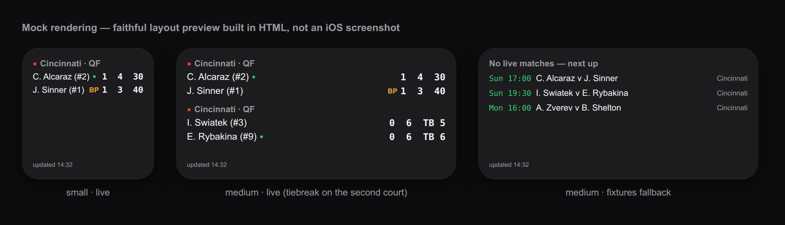

# scriptable-live-tennis

Live tennis scores on your iOS home screen — a [Scriptable](https://scriptable.app) widget
powered by the [Live Tennis API](https://livetennisapi.com) (ATP, WTA, Challenger, ITF and juniors).

*The image above is a **mock rendering** — an HTML preview faithful to the widget layouts,
not an iOS screenshot.*

## What it shows

- **Live matches** (`GET /matches?status=live`): both players with current
  ranking, sets won, games in the current set, in-game points, a green dot
  next to the player serving, and a **BP** marker when the receiver holds a
  break point. Tiebreaks are tagged `TB`.
- **Fixtures fallback** (`GET /fixtures`): when nothing is live, the next
  scheduled matches with start times.
- **Small** widget shows 1 match, **medium** 2, **large** 5.
- Renders friendly in-widget states for *no API key*, *API errors* (falls
  back to the last cached data, marked stale) and *offline*.

The break-point marker is **derived, never guessed**: it lights up only when the
receiver holds `AD`, or the receiver is at `40` while the server is below `40` —
and never during a tiebreak or when the server/points are unknown.

## Setup

1. **Get a free API key** (no card required): <https://livetennisapi.com/subscribe/free>
2. Install [Scriptable](https://apps.apple.com/app/scriptable/id1405459188) and add
   [`live-tennis.js`](live-tennis.js) as a new script (paste the file contents).
3. Add a Scriptable widget to your home screen, long-press it → **Edit Widget**,
   choose the `live-tennis` script, and put your API key in the **Parameter** field.
   - Parameter format: `lt_yourkey` or `lt_yourkey,atp` to filter one tour
     (`atp` | `wta` | `challenger` | `itf` | `juniors`).
   - Alternatively, paste the key into the clearly-marked `API_KEY` constant at
     the top of the script.

## API usage and the free tier — honest math

The widget sets `refreshAfterDate` to **15 minutes** (the script enforces this
as a minimum), so iOS refreshes it **at most ~96 times a day** — in practice
iOS treats that as a hint and usually refreshes less often.

- Each refresh makes **one** request (`/matches?status=live`).
- When nothing is live, the fixtures fallback adds a request **at most once
  per 6 hours** (the response is cached with `FileManager`), i.e. ≤ 4/day.

Worst case: 96 + 4 = **100 requests/day — exactly the free tier's cap**
(100 requests/day, 30/minute), and real-world days land well under it. If you
raise `REFRESH_MINUTES`, usage only goes down. You can check your own
consumption any time via `GET /usage` — that endpoint is quota-exempt.

## Configuration

All knobs are constants at the top of `live-tennis.js`:

| Constant | Default | Meaning |
|---|---|---|
| `API_KEY` | `""` | API key, if you don't want to use the widget parameter (the parameter wins) |
| `TOUR` | `""` | Tour filter when the parameter doesn't set one |
| `REFRESH_MINUTES` | `15` | Refresh hint for iOS; values `< 15` are raised to 15 |
| `FIXTURES_CACHE_MINUTES` | `360` | How long the fixtures fallback is served from cache |
| `MATCH_LIMIT` | `1/2/5` | Matches shown per widget size |

## Data

All fields come from the Live Tennis API's public
[OpenAPI spec](https://docs.livetennisapi.com/openapi.yaml)
(`/matches?status=live` and `/fixtures`, Bearer auth). Both endpoints are on
the **free** tier. Null score points, a null server, and fixtures without an
assigned start time are real states in the feed and the widget renders them
as such (`–` / `TBD`) rather than guessing.

## License

[MIT](LICENSE)
